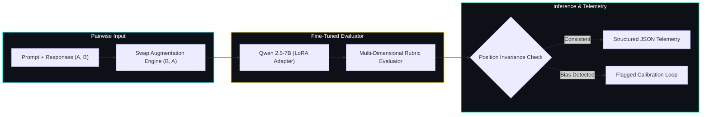
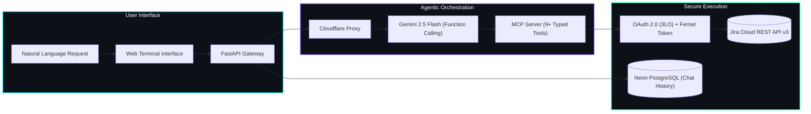
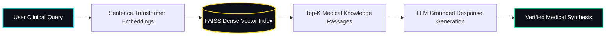
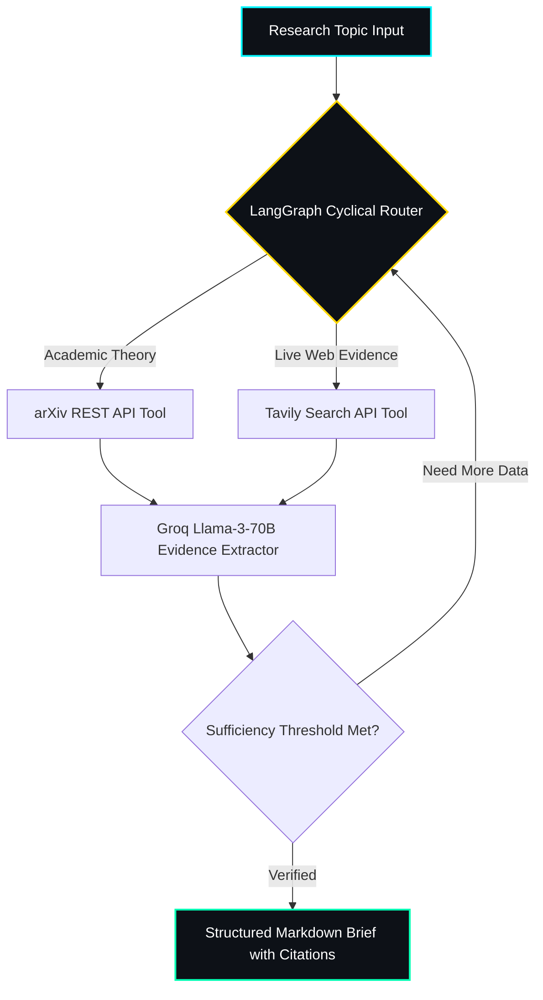
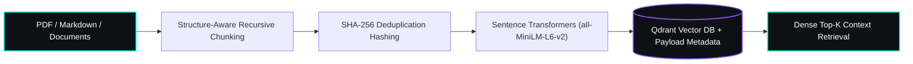
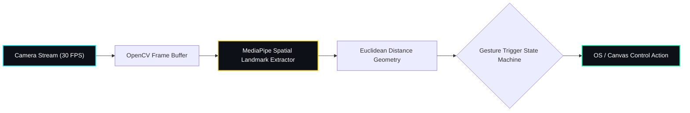

  

  

  
  
  
  
  

 

  <table>
    <tr>
      <td align="center">🎓 <b>Education</b> B.Tech in CSE (Batch 2027) <b>IIIT Bhopal</b></td>
      <td align="center">⚡ <b>Core Focus</b> Agent Orchestration, RAG <b>LLM Fine-Tuning & SFT</b></td>
      <td align="center">🏆 <b>DSA Milestone</b> <b>LeetCode Knight</b> 650+ Problems Solved</td>
      <td align="center">💼 <b>Experience</b> AI Intern @ <b>Solvor</b> Research @ <b>IIIT Bhopal</b></td>
    </tr>
  </table>

---

### 💡 Core Philosophy

> *"I don't just prompt models — I architect intelligent, reliable, and evaluatable production systems."*

- 🤖 **Agentic & Foundation Systems:** Hands-on experience developing autonomous multi-agent workflows, Model Context Protocol (MCP) servers, and training custom causal GPT architectures from scratch in PyTorch.
- 🔬 **Evaluations & Alignment:** Fine-tuned `Qwen2.5-7B` with LoRA across 25K+ preference pairs, implementing swap-augmentation pipelines to achieve position-bias invariance and 91% benchmark accuracy.
- 🏗️ **Production-Grade Engineering:** Microservices built with FastAPI, OAuth 2.0 (3LO), Fernet symmetric encryption, Neon PostgreSQL, Docker, and Qdrant/FAISS vector databases.

---

## 🚀 Engineering Arsenal & Flagship Systems

  

  <b>🔥 CLICK TO EXPAND / COLLAPSE SYSTEM ARCHITECTURES</b>

 

### 1️⃣ [LLM as Judge Platform](https://github.com/AnmolRajpoot25/LLM_as_Judge)
> **Fine-tuned LLM evaluation platform with pairwise judging, position-bias elimination, and structured telemetry.**
- **Tech Stack:** `PyTorch 2.x` • `Qwen 2.5-7B` • `PEFT / LoRA (r=16, α=32)` • `FastAPI` • `React 18` • `TypeScript`
- **Key Milestones:** **91% accuracy** on a 100-case hard benchmark; swap-augmentation training eliminates order bias; guarantees 100% valid JSON schema output.

---

### 2️⃣ [Zira Automation Agent](https://github.com/AnmolRajpoot25/Zira_automation_Agent) • [🌐 Live Demo](https://zira-automation-agent.onrender.com/)
> **Autonomous Jira agent executing complex issue lifecycles via authenticated Model Context Protocol (MCP) tool calls.**
- **Tech Stack:** `Gemini 2.5 Flash` • `FastAPI (Asyncio)` • `Model Context Protocol (MCP)` • `OAuth 2.0 (3LO)` • `Neon PostgreSQL` • `Cloudflare Workers` • `Fernet-256`
- **Key Milestones:** Authenticated 4+ step issue workflows; encrypted token storage; 9+ typed MCP Jira tools.

---

### 3️⃣ [GPT-Style LLM from Scratch](https://github.com/AnmolRajpoot25/AI_personal_assistant_LLM_from_scratch)
> **PyTorch implementation of a generative causal language model from byte-pair tokenization to FastAPI serving.**
- **Tech Stack:** `PyTorch 2.x` • `Causal Decoder Blocks` • `Masked Multi-Head Attention` • `BPE (50k Vocab)` • `LayerNorm & GELU` • `FastAPI`
- **Key Milestones:** Implemented token & position embeddings, residual connections, causal masking, pretraining loop, instruction fine-tuning, and top-k/top-p nucleus sampling.

```mermaid
flowchart LR
    A["Raw Text Corpus"] --> B["BPE Tokenizer (50K Vocab)"]
    B --> C["Token + Positional Embeddings"]
    C --> D["Masked Multi-Head Attention Blocks"]
    D --> E["Feed-Forward Networks (GELU + LayerNorm)"]
    E --> F["Pretraining & SFT Loop"]
    F --> G["FastAPI Top-K / Top-P Sampling Engine"]

    style A fill:#0d1117,stroke:#00F7FF,stroke-width:2px,color:#fff
    style D fill:#0d1117,stroke:#FFD700,stroke-width:2px,color:#fff
    style G fill:#0d1117,stroke:#00FFB3,stroke-width:2px,color:#fff
```

---

### 4️⃣ [Medical Chatbot & Semantic RAG](https://github.com/AnmolRajpoot25/medical_chatbot)
> **Document-grounded healthcare assistant with dense vector search, similarity thresholding, and hallucination reduction.**
- **Tech Stack:** `Flask` • `FAISS (IndexFlatL2)` • `Sentence Transformers (all-MiniLM-L6-v2)` • `PyPDF` • `Hugging Face`
- **Key Milestones:** 384-dimensional dense semantic search; semantic overlap chunking; grounded context verification.

---

### 5️⃣ [Multi-Source Research Agent](https://github.com/AnmolRajpoot25/research-AI_agent)
> **LangGraph-driven cyclical agent coordinating live web searches and scientific arXiv retrieval to formulate cited technical briefs.**
- **Tech Stack:** `LangGraph (Cyclical StateGraph)` • `LangChain v0.3` • `Groq LPU (Llama-3-70B @ 750 t/s)` • `Tavily Search API` • `arXiv REST API` • `Streamlit`
- **Key Milestones:** Autonomous cyclical routing; multi-source factual verification; dynamic abstract synthesis with citations.

---

### 6️⃣ [Smart Ingestion & Vector Retrieval Engine](https://github.com/AnmolRajpoot25/smart-ingestion-engine)
> **High-throughput document ingestion with sliding token overlap, SHA-256 deduplication, and Qdrant vector indexing.**
- **Tech Stack:** `Python 3.12 Asyncio` • `Qdrant Vector DB` • `Sentence Transformers` • `PyPDF` • `FastAPI`
- **Key Milestones:** Structure-aware markdown/PDF hierarchy parsing; customizable token overlap windows; batch-optimized dense vector embeddings.

---

### 7️⃣ Computer Vision & Real-Time Gestures
> **Interactive landmark geometry, skeleton tracking, and trigger state machines.**
- **Tech Stack:** `OpenCV 4` • `MediaPipe Hands (21 3D Landmarks)` • `MediaPipe Pose (33 Landmarks)` • `Face Mesh (468 Points)`
- **Key Milestones:** Real-time 30 FPS frame buffering; spatial landmark Euclidean geometry; state-machine-driven gesture actions.

  

## 🛠️ Technical Skills & Ecosystem

<table align="center" width="100%">
  <tr>
    <td width="30%" valign="top"><b>🤖 AI & Foundation Models</b></td>
    <td width="70%">
      <code>PyTorch 2.x</code> • <code>Hugging Face Transformers</code> • <code>Qwen 2.5</code> • <code>PEFT / LoRA / QLoRA</code> • <code>Causal Attention</code> • <code>BPE Tokenization</code> • <code>SFT & Preference Alignment</code> • <code>Groq LPU</code> • <code>Gemini 2.5</code>
    </td>
  </tr>
  <tr>
    <td width="30%" valign="top"><b>⚡ Agent Orchestration & RAG</b></td>
    <td width="70%">
      <code>LangGraph (Cycle Routing)</code> • <code>LangChain v0.3</code> • <code>Model Context Protocol (MCP)</code> • <code>Qdrant</code> • <code>FAISS</code> • <code>PGVector</code> • <code>ChromaDB</code> • <code>Sentence Transformers</code> • <code>Hybrid Retrieval</code>
    </td>
  </tr>
  <tr>
    <td width="30%" valign="top"><b>🌐 Backend & Systems</b></td>
    <td width="70%">
      <code>Python 3.12 (Asyncio)</code> • <code>FastAPI</code> • <code>Flask</code> • <code>PostgreSQL (Neon)</code> • <code>SQLAlchemy 2.0</code> • <code>OAuth 2.0 (3LO)</code> • <code>Fernet-256 Encryption</code> • <code>Cloudflare Workers</code> • <code>RESTful APIs</code> • <code>Docker</code>
    </td>
  </tr>
  <tr>
    <td width="30%" valign="top"><b>📊 Classical ML & Data Science</b></td>
    <td width="70%">
      <code>Scikit-learn</code> • <code>XGBoost</code> • <code>PyTorch LSTM / Bi-LSTM</code> • <code>Random Forests</code> • <code>Pandas</code> • <code>NumPy</code> • <code>FRED API</code> • <code>EDA & Visualization</code>
    </td>
  </tr>
  <tr>
    <td width="30%" valign="top"><b>👁️ Computer Vision & Web Tools</b></td>
    <td width="70%">
      <code>OpenCV 4</code> • <code>MediaPipe (Hands / Pose / Face Mesh)</code> • <code>JavaScript (ES2024)</code> • <code>Chrome Extensions Manifest V3</code> • <code>Service Workers</code>
    </td>
  </tr>
  <tr>
    <td width="30%" valign="top"><b>🏛️ Computer Science Core</b></td>
    <td width="70%">
      <code>Data Structures & Algorithms (C++)</code> • <code>OOP (SOLID)</code> • <code>Operating Systems</code> • <code>DBMS</code> • <code>Computer Networks</code> • <code>High-Level System Design</code>
    </td>
  </tr>
</table>

  

  

## 🎯 Problem Solving & Algorithms

  <table>
    <tr>
      <td align="center" width="50%">
        
      </td>
      <td align="center" width="50%">
        
<b>🏆 LeetCode Knight (Top 5%)</b>

        

            
            
          
        

      </td>
    </tr>
  </table>

---

## 📈 GitHub Telemetry

  
  

---

## 💼 Experience & Leadership Highlights

- 🏢 **AI Intern @ Solvor (Nov 2025 – Jan 2026):** Engineered an LLM revision assistant and MCQ generator with LangChain and FastAPI; achieved a **20%+ improvement in response relevance**.
- 🔬 **Research Intern @ IIIT Bhopal (Feb 2026 – Apr 2026):** Conducted short-term solar load forecasting over the Ausgrid dataset (300+ households, 3+ years), benchmarking Random Forest, XGBoost, and PyTorch LSTMs.
- 🎓 **Vice President @ ARC, IIIT Bhopal:** Led career mentorship sessions and coding workshops for **350+ undergraduate students**.

---

## 🤝 Let's Collaborate & Connect

Whether you want to discuss **LLM evaluations**, **agentic workflows**, **distributed AI pipelines**, or open opportunities:

  
  
  

  

